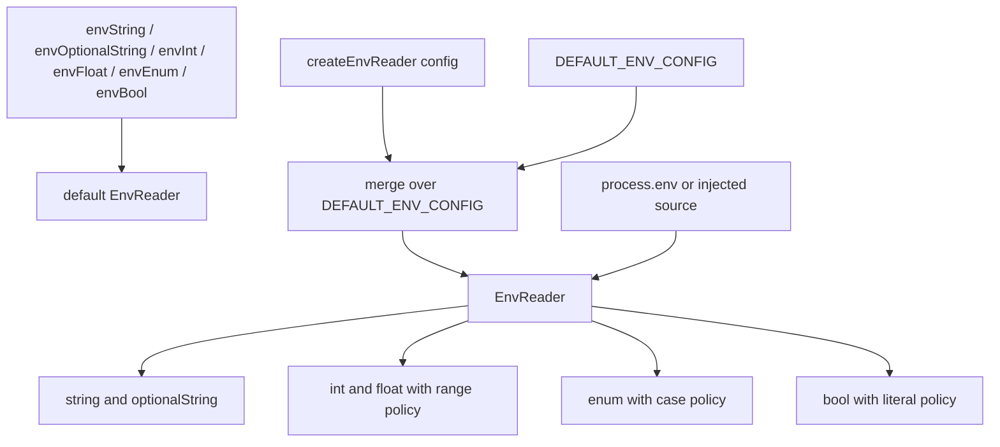

# Architecture

## Overview

`@johannes.latzel/env` has one implementation module, `src/lib/env.ts`, and one public entry point, `src/index.ts`. The default helpers delegate to one `EnvReader`; `createEnvReader` builds readers with merged configuration.

## Reader Pipeline

1. `createEnvReader(config)` merges the caller's defined fields over the frozen
   `DEFAULT_ENV_CONFIG` into a new resolved configuration. Within that merge,
   `source` falls back to `process.env`.
2. Each helper reads one raw string from the configured source.
3. String helpers apply the empty-string policy and, for optional strings, the
   optional trim policy.
4. Numeric helpers parse with `Number` (strict) or a leading numeric prefix
   (lenient), reject non-finite or non-integer values where required, and then
   apply the range policy.
5. Enum and boolean helpers compare against their configured literals with the
   configured case policy.

The top-level `envString`, `envOptionalString`, `envInt`, `envFloat`,
`envEnum` and `envBool` functions delegate to one default reader, so the
package has a single behavior implementation.

## Failure Behavior

Helpers never throw for malformed values. They return the supplied default; if
no default is supplied, they return `undefined`. Authorization and validation
stay in the consuming package.
